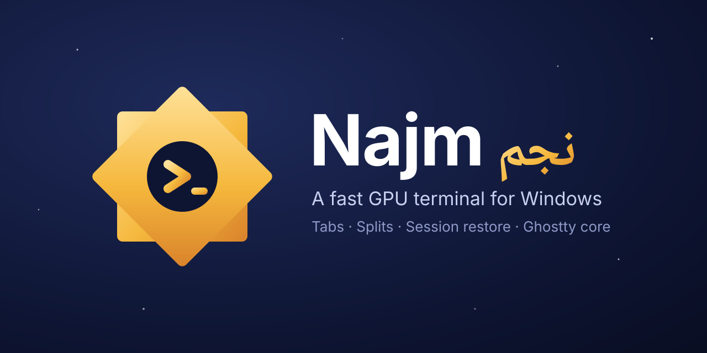
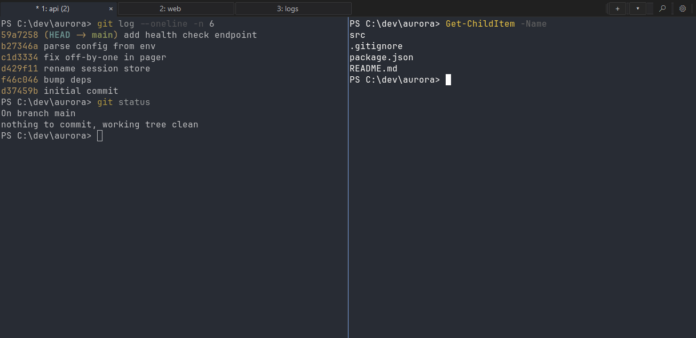

<p align="center">
  
</p>

<h1 align="center">Najm: a fast, GPU-accelerated terminal for Windows</h1>

<p align="center">
  <a href="https://github.com/Vette1123/najm/releases/latest"></a>
  <a href="https://github.com/Vette1123/najm/actions/workflows/najm-ci.yml"></a>
  
  <a href="LICENSE"></a>
</p>

<p align="center">
  <b><a href="https://vette1123.github.io/najm/download/">Download</a></b>
  ·
  <a href="https://vette1123.github.io/najm/">Website</a>
  ·
  <a href="#features">Features</a>
  ·
  <a href="#arabic-text">Arabic</a>
  ·
  <a href="https://vette1123.github.io/najm/ar/">العربية</a>
  ·
  <a href="#configure">Configure</a>
</p>

<p align="center">
  
</p>

---

**Najm** (Arabic for *star*, نجم) is a free, open-source, native Windows terminal emulator built
on [Ghostty](https://github.com/ghostty-org/ghostty)'s terminal core. It draws on the GPU, opens
in tabs and splits, and restores your session. It runs PowerShell,
Command Prompt, Git Bash and WSL with no setup.

Looking for [Ghostty on Windows](https://vette1123.github.io/najm/ghostty-for-windows/) or a
[Windows Terminal alternative](https://vette1123.github.io/najm/windows-terminal-alternative/)?
Najm reads Ghostty's config syntax and installs beside Windows Terminal. If it works for you, a
star helps other people find it.

Najm is a fork of [Noctty](https://github.com/amanthanvi/noctty), which brought Ghostty to
Windows. We follow Noctty closely and ship our own fixes on top, without waiting for them to be
merged.

## Why Najm

- It is fast. Ghostty's VT core draws through OpenGL, capped to your refresh rate so it does not
  burn battery. Where OpenGL is missing, such as Remote Desktop or a VM without 3D acceleration,
  a Direct3D 11 renderer (beta) takes over.
- It is a native Win32 app, with real tabs, splits, context menus, per-monitor DPI, IME input,
  jump lists and toasts.
- One line in your config makes `Ctrl+V` paste the way Windows Terminal does: text, the paths of
  files copied in Explorer, and images, so tools like
  [Claude Code and opencode can attach screenshots](https://vette1123.github.io/najm/paste-images-claude-code-windows/).
- It sends no telemetry. Its only network call is the update check against this repo's
  releases, and you can turn that off.

## Features

| | |
|---|---|
| **Tabs and splits** | `Ctrl+Shift+T` for a new tab, `Ctrl+Shift+\` and `Ctrl+Shift+E` to split, `Alt+Arrow` to move between panes |
| **Session restore** | Windows, tabs, splits and working directories come back after a restart |
| **Command palette** | `Ctrl+Shift+P` reaches every action by name |
| **Shell picker** | Finds PowerShell 7, Windows PowerShell, cmd, Git Bash and every WSL distro |
| **Explorer menu** | "Open Najm here" on any folder, or the empty space inside one |
| **Themes** | Hundreds built in: `najm +list-themes` |
| **Graphics** | Kitty graphics protocol and inline images |
| **Keyboard** | Kitty keyboard protocol, with left/right modifiers and key release events |
| **Shell integration** | Prompt marks, jump to the previous or next command, and a toast when a command finishes |
| **Clipboard** | Bracketed paste, OSC 52, copied files paste as paths, and an empty paste for image-aware apps |
| **Updates** | Built-in, signed and checksum-verified, from this repository's releases |

## Install

**Requirements:** Windows 10 version 1809 or later, or Windows 11, on x64. The default renderer
needs a GPU driver with OpenGL 4.3. Najm switches to its Direct3D 11 renderer when OpenGL is
not available.

1. Download `najm-<version>-windows-x64-setup.exe` from the
   **[latest release](https://github.com/Vette1123/najm/releases/latest)**.
2. Run it. Najm signs its builds with its own certificate, which Windows does not know yet, so
   SmartScreen shows "Windows protected your PC" the first time. Click **More info**, then
   **Run anyway**.
3. Open **Najm** from the Start menu.

Prefer no installer? The same release has a portable ZIP: unzip it anywhere and run `najm.exe`.

<details>
<summary>Check the download first</summary>

Hash the file and compare the result with its line in `SHA256SUMS-windows-x64.txt` from the same
release:

```powershell
Get-FileHash .\najm-1.0.0-windows-x64-setup.exe -Algorithm SHA256
```

The installer and every program file in it are signed by `CN=Najm Code Signing` (thumbprint
`26D9DB30682A45008C05E08729B7CC9016D492FB`). The in-app updater refuses anything signed by
another key.

</details>

## Configure

Najm reads `%LOCALAPPDATA%\najm\config.ghostty`. It uses the same syntax as Ghostty, so most
Ghostty options and themes work as they are. Open it with:

```powershell
notepad "$env:LOCALAPPDATA\najm\config.ghostty"
```

A good start:

```ini
font-family = JetBrains Mono
font-size   = 12
theme       = Dracula
command     = pwsh

# Ctrl+V pastes text, copied files and images, as in Windows Terminal
keybind = performable:ctrl+v=paste_from_clipboard
```

Press `Ctrl+Shift+,` to reload. `najm +show-config --default --docs` lists every option.

## Arabic text

Arabic and Hebrew read right to left in command output and at the prompt, with joined letters, and
the cursor, selection, search and links follow what you see. A line that starts with Arabic or
Hebrew aligns right; one that starts with Latin stays left, and any Arabic inside it still reads
correctly. Set `bidi = false` to turn this off.

Limits: full-screen apps keep every column where they put it, because they place every cell
themselves. Claude Code on Windows reverses its own Arabic for this, so it reads correctly with
joined letters; an app that writes Arabic in typing order, such as vim, reads backwards.
The line you are composing with an IME stays in typing order until you commit it. Lam-alef is one
form in two cells, so a blank cell sits on its left.

The default terminal fonts have no Arabic, so Windows draws it in Segoe UI, a proportional font
that sits unevenly in the cell grid. Map the Arabic blocks to a monospace font that has them:

```ini
font-codepoint-map = U+0600-U+06FF,U+0750-U+077F,U+08A0-U+08FF,U+FB50-U+FDFF,U+FE70-U+FEFF=Cascadia Code NF
```

The copy of Cascadia Code that ships with Windows has no Arabic. Install the current release from
[microsoft/cascadia-code](https://github.com/microsoft/cascadia-code/releases), which has.
`najm +show-face --string="مرحبا"` shows which font each letter comes from. The
[Arabic text guide](https://vette1123.github.io/najm/arabic-terminal-windows/) has more.

## Keyboard shortcuts

| Action | Keys |
|---|---|
| Copy / paste | `Ctrl+Shift+C` / `Ctrl+Shift+V` (or `Ctrl+V` with the line above) |
| New tab / close tab | `Ctrl+Shift+T` / `Ctrl+Shift+W` |
| Split right / down | `Ctrl+Shift+\` / `Ctrl+Shift+E` |
| Move between panes | `Alt+Arrow` |
| Go to tab 1 to 8 / last tab | `Alt+1` to `Alt+8` / `Alt+9` |
| Command palette | `Ctrl+Shift+P` |
| Find | `Ctrl+Shift+F` |
| Font size | `Ctrl+=` / `Ctrl+-` |
| Reload config | `Ctrl+Shift+,` |

`najm +list-keybinds` prints the full set.

## Build from source

You need Zig 0.15.2, Visual Studio 2022 (or Build Tools) with the MSVC toolchain, and Git for
Windows.

```powershell
scripts\dev-windows.cmd zig build -Demit-exe=true -Doptimize=ReleaseFast
```

The binary lands in `zig-out\bin\najm.exe`. Run the tests with
`zig build test -Demit-test-exe=true --summary all`.

## How Najm relates to Noctty and Ghostty

```
Ghostty (terminal core, macOS and Linux)
  └── Noctty (Ghostty's core in a native Windows app)
        └── Najm (Noctty plus our fixes, our name, our releases)
```

Najm merges Noctty regularly with `scripts/najm-sync.ps1` and keeps its own changes small: the
name, the icon, the update feed, and fixes we ship before they land upstream. Fixes that help
everyone go back to Noctty as pull requests too. [SYNCING.md](SYNCING.md) has the details.

Najm is not affiliated with the Ghostty or Noctty projects.

## License

MIT, as Ghostty and Noctty are. Copyright © 2024 Mitchell Hashimoto, Ghostty contributors;
Noctty's Windows work © Aman Thanvi and contributors; Najm's changes © Mohamed Gado. See
[LICENSE](LICENSE).
